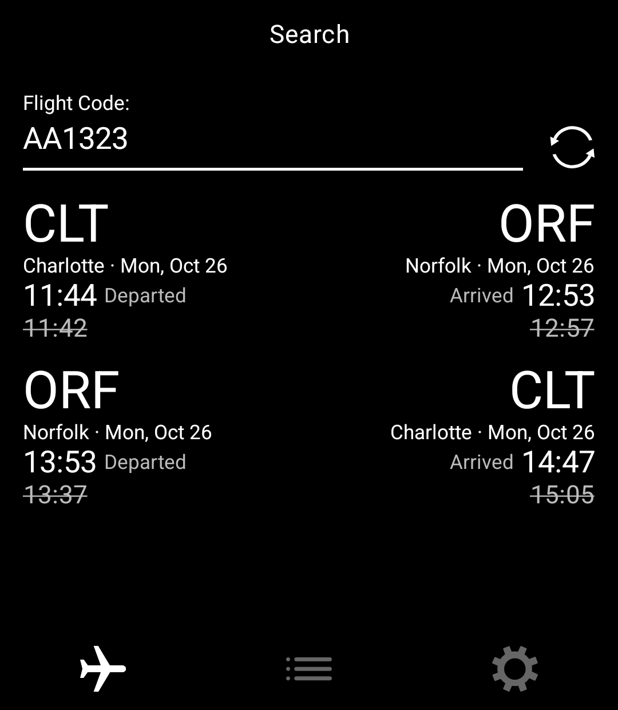
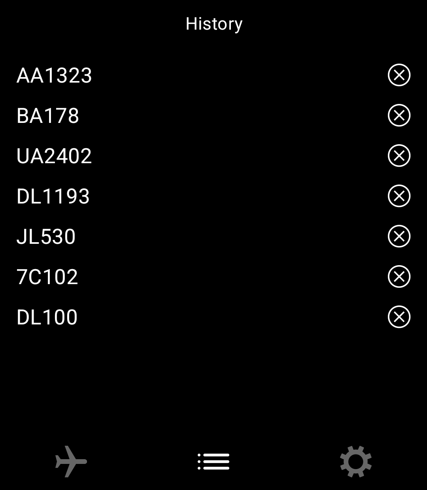
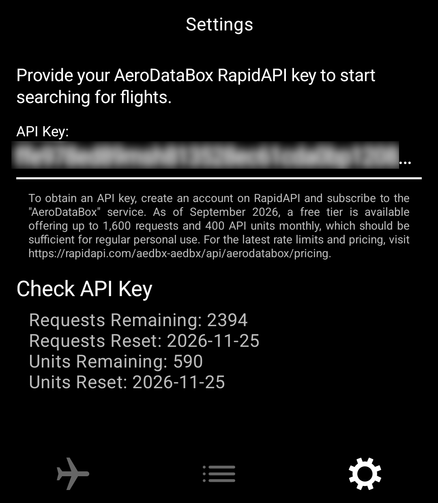

 

  

A flight-status lookup tool for the Light Phone III, built with the [Light SDK](https://github.com/lightphone/light-sdk).

Search by flight number to view available flight status and departure and arrival details.

Recent searches are saved locally and can accessible from the app's history screen.

 

Flights uses AeroDataBox through [RapidAPI](https://rapidapi.com/aedbx-aedbx/api/aerodatabox). Add your RapidAPI key in the app's Settings. The key is stored on your device and sent with API requests.

Flight-number searches and API-usage checks are sent to RapidAPI to retrieve results.

Flights has no app-operated backend, analytics, or advertising.

 

---

## Gallery

  
  
  

## Development

See the [Light SDK README](https://github.com/lightphone/light-sdk/blob/main/README.md) for SDK setup, build, and run instructions.

For the optional Nix development environment and emulator scripts, see [`local-dev/README.md`](local-dev/README.md).
